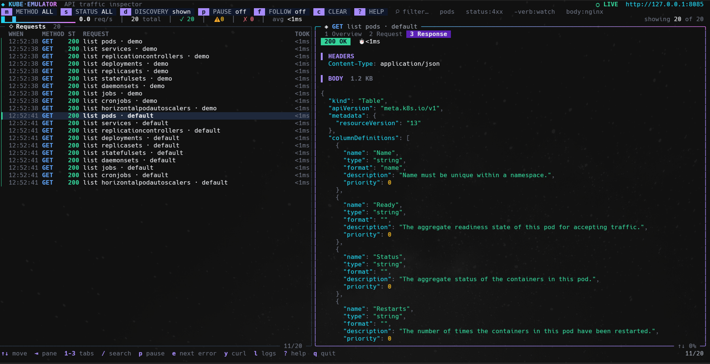

# kube-emulator + Live Kubernetes API request/response inspection

A fake Kubernetes API server written in Go. It speaks the Kubernetes REST API,
so `kubectl` (and client libraries) work against it, but it **never starts a
container**: objects live in memory or in an SQLite database, and a few
simulated controllers fill in the status a real cluster would report.

Default address: `http://127.0.0.1:8085`.



## Build and run

```bash
go mod tidy                      # resolves indirect dependencies, writes go.sum
go build -o kube-emulator ./cmd/kube-emulator

./kube-emulator                                   # in-memory, port 8085
./kube-emulator --storage=sqlite                  # persisted in ./kube-emulator.db
./kube-emulator --storage=sqlite --sqlite-path=/tmp/k8s.db --port=9000
./kube-emulator --write-kubeconfig=./emulator.kubeconfig
./kube-emulator -nodes 3 -v --openapi-spec=./examples/swagger.json # To support kubectl explain
```

### kubectl

```bash
KUBECONFIG=./emulator.kubeconfig
./kube-emulator --nodes=3 --seed-dir=./examples/scheduling
kubectl get nodes -o wide
kubectl apply -f examples/scheduling/pods.yaml
kubectl get pods -o wide
kubectl describe pod too-big
kubectl apply -f examples/lifecycle/pods.yaml
kubectl get pods -w
kubectl get events --sort-by=.lastTimestamp
```

| Flag | Default | Meaning |
|---|---|---|
| `--port` | `8085` | listen port |
| `--bind-address` | `127.0.0.1` | listen address (`0.0.0.0` to expose it) |
| `--storage` | `memory` | `memory` or `sqlite` |
| `--sqlite-path` | `kube-emulator.db` | database file for `--storage=sqlite` |
| `--write-kubeconfig` | – | also write a kubeconfig pointing at the server |
| `--kinds-dir` | – | folder of CRD files; the kinds they define are served (see below) |
| `--kinds-reload` | `2s` | how often the folder is re-scanned (`0` = only at start-up) |
| `--openapi-spec` | – | `swagger.json` whose definitions power `kubectl explain` (see below) |
| `--env-file` | `.env` | file with default settings (see below) |
| `--nodes` | `1` | number of fake nodes `emulator-node-1..N` |
| `--node-cpu`, `--node-memory`, `--node-pods` | `8`, `16Gi`, `110` | capacity of generated nodes (and default for nodes created without capacity) |
| `--delays` | – | pod lifecycle delays, e.g. `pull=3s,ready=5s`, or `instant` |
| `--seed-dir` | – | folder of manifests created at start-up when missing |
| `--tui` | off | terminal UI with a live request/response inspector (see below) |
| `-v` | off | dump every request (full headers and body) and log its duration |

## Project layout

```
kube-emulator/
├── go.mod
├── cmd/
│   └── kube-emulator/
│       └── main.go          # flags, storage selection, wiring, graceful shutdown
└── internal/
    ├── store/               # in-memory store, resourceVersions, watch, SQLite persistence
    │   ├── store.go
    │   └── sqlite.go
    ├── registry/            # served resources (built-in + CRDs), discovery, OpenAPI stubs
    │   └── registry.go
    ├── events/              # Event recorder (aggregation, like the real one)
    │   └── events.go
    ├── kubesim/             # fake nodes, scheduler, kubelet lifecycle simulation
    │   ├── nodes.go  scheduler.go  predicates.go  kubelet.go  delays.go  common.go
    ├── trace/               # records every request/response (ring buffer) for the UI
    │   └── trace.go
    ├── tui/                 # terminal UI (--tui): Bubble Tea + Lip Gloss
    │   ├── model.go  detail.go  format.go  filter.go  theme.go  logs.go  run.go
    ├── config/              # .env parsing and flag/env/.env precedence
    │   └── dotenv.go
    ├── openapi/             # swagger.json definitions -> OpenAPI v2 / v3 documents (kubectl explain)
    │   └── openapi.go
    ├── objects/             # shared helpers: typed<->unstructured, defaults, validation, pod/IP simulation
    │   ├── convert.go
    │   ├── validate.go
    │   └── sim.go
    ├── controllers/         # simulated controllers and cluster bootstrap
    │   ├── controllers.go   #   Deployment, ReplicaSet, StatefulSet, DaemonSet, Job, Endpoints, GC
    │   ├── bootstrap.go     #   default namespaces, fake node, "kubernetes" service
    │   └── aliases.go
    └── server/              # HTTP layer
        ├── server.go        #   routing, discovery, REST handlers, watch, patch
        ├── admit.go         #   decode, default, validate, create/update pipeline, CRDs
        ├── tables.go        #   server-side Tables for `kubectl get`
        └── aliases.go
```

Dependencies only point downwards: `main` -> `server`, `controllers` ->
`openapi`, `kubesim` (also used by `controllers`) -> `events` -> `objects` -> `registry` -> `store` (`config` is used by `main` only).

## Loading kinds from a folder (no code changes)

Built-in kinds (Pod, Deployment, ...) are compiled in, but **any other kind can
be added at run time with a CustomResourceDefinition file**:

```bash
./kube-emulator --kinds-dir=./examples/kinds
kubectl api-resources | grep example.com
kubectl apply -f examples/widget.yaml
kubectl get widgets          # or: kubectl get wg
kubectl apply -f examples/widget.yaml   # a Widget with spec.size: 99 is rejected by the CRD schema
```

* Put any number of `*.yaml`, `*.yml` or `*.json` files in the folder
  (sub-folders are searched; multi-document files and `kind: List` work). Good
  sources are `kubectl get crd <name> -o yaml` on a real cluster, or the
  `config/crd/bases` folder of an operator repository.
* The folder is read at start-up and re-scanned every `--kinds-reload`:
  a new or changed file creates/updates the CRD and the kind is served
  immediately; a deleted file (or a CRD removed from a file) deletes the CRD
  and all of its resources. Only CRDs that came from the folder are pruned;
  CRDs created with `kubectl` are left alone.
* Files go through the same validation as a CRD sent by `kubectl`, and
  resources are validated against the CRD's `openAPIV3Schema` (status
  subresource and short names are honoured). Files with errors are logged and
  skipped.
* Other kinds of manifests in the folder are ignored. A folder cannot add new
  *built-in* kinds or older API versions of built-in kinds, because those need
  Go types for typed validation.

## Configuration with a .env file

Every flag has a `KUBE_EMULATOR_*` variable. Put defaults in a `.env` file in
the directory you start the emulator from (or choose one with `--env-file`):

```
KUBE_EMULATOR_PORT=9000
KUBE_EMULATOR_STORAGE=sqlite
KUBE_EMULATOR_SQLITE_PATH=./data/emulator.db
KUBE_EMULATOR_KINDS_DIR=./kinds
KUBE_EMULATOR_OPENAPI_SPEC=./swagger.json
```

**Precedence, highest first:** command line flags, real environment variables,
the `.env` file, built-in defaults. So `./kube-emulator --port=8086` wins over
`KUBE_EMULATOR_PORT=9000` in `.env`. A missing default `.env` is ignored; a
missing file given with `--env-file`, or an invalid value, is an error. At
start-up the emulator logs every setting it took from the environment or `.env`.
The file may contain comments, `export KEY=value`, quoted values and Windows
line endings; see `.env.example` for every key.

| Flag | Variable |
|---|---|
| `--port` | `KUBE_EMULATOR_PORT` |
| `--bind-address` | `KUBE_EMULATOR_BIND_ADDRESS` |
| `--storage` | `KUBE_EMULATOR_STORAGE` |
| `--sqlite-path` | `KUBE_EMULATOR_SQLITE_PATH` |
| `--write-kubeconfig` | `KUBE_EMULATOR_WRITE_KUBECONFIG` |
| `--kinds-dir` | `KUBE_EMULATOR_KINDS_DIR` |
| `--kinds-reload` | `KUBE_EMULATOR_KINDS_RELOAD` |
| `--openapi-spec` | `KUBE_EMULATOR_OPENAPI_SPEC` |
| `--nodes` | `KUBE_EMULATOR_NODES` |
| `--node-cpu` | `KUBE_EMULATOR_NODE_CPU` |
| `--node-memory` | `KUBE_EMULATOR_NODE_MEMORY` |
| `--node-pods` | `KUBE_EMULATOR_NODE_PODS` |
| `--delays` | `KUBE_EMULATOR_DELAYS` |
| `--seed-dir` | `KUBE_EMULATOR_SEED_DIR` |
| `--tui` | `KUBE_EMULATOR_TUI` |
| `-v` | `KUBE_EMULATOR_VERBOSE` |

## kubectl explain

`kubectl explain` needs the schemas of the kinds, which the emulator does not
contain. Give it the `definitions` of an OpenAPI v2 `swagger.json`:

```bash
# from a real cluster ...
kubectl get --raw /openapi/v2 > swagger.json
# ... or from the Kubernetes repository: api/openapi-spec/swagger.json

./kube-emulator --openapi-spec=./swagger.json
kubectl explain deployment.spec.strategy
kubectl explain pod --recursive
```

* The file is served as `/openapi/v2`, and per group/version OpenAPI v3
  documents (the format `kubectl explain` uses by default) are derived from the
  same definitions, so both `kubectl explain` and
  `kubectl explain --output=plaintext-openapi-v2` work.
* Custom kinds loaded with `--kinds-dir` (or created from a CRD) are explained
  from the `openAPIV3Schema` of their CRD; no swagger file is needed for them.
* Use a swagger file from a Kubernetes version close to the emulator's reported
  version (v1.31). With a spec loaded, kubectl also validates manifests
  client-side against these schemas, as it does against a real cluster.

## Nodes, scheduling, pod lifecycle and events

Pods are no longer Running the instant they are created. A simulated scheduler
and kubelets move them through a realistic life, and every step leaves events.

### Fake nodes and the scheduler

`--nodes=3` creates `emulator-node-1..3` (node 1 is labelled `control-plane`,
the others `worker`; zones `zone-a/b/c` in turn). Nodes are ordinary Node
objects: create more, with any labels, taints and capacity, using
`kubectl apply` or `--seed-dir` (see `examples/scheduling/nodes.yaml`); a node
created without status gets a Ready condition, addresses and the default
capacity. `kubectl cordon`, `uncordon`, `taint`, `label` and `drain` work (drain
evicts through `pods/eviction`; pod disruption budgets are not consulted).
Deleting a node deletes its pods after ten seconds.

The scheduler binds a pod to a node that passes all of these, then prefers
nodes matching *preferred* node affinity and, after that, the node with the
fewest pods:

* not cordoned (`spec.unschedulable`) and Ready
* `nodeSelector` and required node affinity (the real
  `k8s.io/component-helpers` matcher, so all operators work)
* taints: `NoSchedule` and `NoExecute` taints need a matching toleration
* resources: the sum of container requests (limits count as requests,
  init containers as a maximum) must fit the node's allocatable minus what is
  already placed, including extended resources such as `nvidia.com/gpu`, and
  the pod count limit
* required pod affinity and anti-affinity with any `topologyKey`

A pod that fits nowhere stays `Pending` with `PodScheduled=False` and a
`FailedScheduling` event such as `0/3 nodes are available: 1 node(s) had
untolerated taint {dedicated: gpu}, 2 Insufficient cpu.` It is retried
continuously, so it is bound as soon as you add a node, uncordon or remove a
taint. Not supported: topology spread constraints, preemption/priorities,
`NoExecute` eviction of running pods, and the DaemonSet `maxUnavailable` logic.

### Pod lifecycle

`Pending` (scheduling) -> `ContainerCreating` (image pull) -> `Running`
(not ready) -> `Ready`, with these default delays, which `--delays` changes
(`--delays=instant` removes all waiting):

| name | default | meaning |
|---|---|---|
| `schedule` | `300ms` | Pending until the scheduler binds the pod |
| `pull` | `1s` | image pull (`ContainerCreating`) |
| `start` | `300ms` | container creation after the pull |
| `ready` | `1s` | Running until the readiness probe succeeds |
| `job` | `3s` | how long pods of Jobs (`restartPolicy` Never/OnFailure) run before they complete |
| `terminate` | `1s` | `Terminating` until the pod is gone (never longer than its grace period) |
| `backoff` | `10s` | first back-off of `CrashLoopBackOff`/`ImagePullBackOff`; doubles up to 5m |

Annotations on a pod (put them in the pod *template* of a Deployment, Job, ...)
override the delays and inject failures; see `examples/lifecycle/pods.yaml`:

| annotation | effect |
|---|---|
| `emulator.kube/delay-<name>: 5s` | overrides one delay (`schedule`, `pull`, `start`, `ready`, `job`, `terminate`, `backoff`) for this pod |
| `emulator.kube/fail-image-pull: "true"` | `ErrImagePull` <-> `ImagePullBackOff` forever |
| `emulator.kube/crash: "true"` | the container exits and is restarted with growing back-off (`CrashLoopBackOff`, `restartCount` rises); with `restartPolicy: Never` the pod becomes `Failed` |
| `emulator.kube/crash-after: 2s` | how long it runs before crashing (default `1s`) |
| `emulator.kube/crash-exit-code: "3"` | exit code reported in `lastState` (default `1`) |
| `emulator.kube/fail-readiness: "true"` | Running but never Ready, with `Unhealthy` events |

Deleting a pod is graceful: it shows `Terminating`, the kubelet emits `Killing`
and the pod disappears after the `terminate` delay (`kubectl delete pod x
--force --grace-period=0` removes it at once). To make this work, every pod
carries the finalizer `emulator.kube/kubelet`, which you will see in
`kubectl get pod -o yaml`.

Controllers follow the real pod state: ReplicaSet/Deployment/StatefulSet/
DaemonSet status uses *ready* pods, so `kubectl rollout status` waits for
readiness. Deployments roll out gradually with `maxSurge`/`maxUnavailable`
(or `Recreate`): a new version whose pods never become ready stalls while the
old pods keep serving. StatefulSets create pods in order (`OrderedReady`) and
update them from the highest ordinal. Jobs honour `completions`, `parallelism`
and `backoffLimit` (failed pods count; `BackoffLimitExceeded` fails the job),
and Services only list *ready* pods as endpoints (others appear under
`notReadyAddresses`).

### Events

`kubectl describe` and `kubectl get events` show what happened, with the same
reasons as a real cluster: `Scheduled`, `FailedScheduling`, `Pulling`,
`Pulled`, `Created`, `Started`, `Killing`, `BackOff`, `Failed`, `Unhealthy`, and
from the controllers `ScalingReplicaSet`, `SuccessfulCreate`,
`SuccessfulDelete`, `Completed`, `BackoffLimitExceeded`. Repeated events are
aggregated (`count`, `lastTimestamp`), events expire after an hour, and
`kubectl get pods -o wide` shows IP and node.

## Terminal UI (`--tui`)

```bash
./kube-emulator --tui --nodes=3
```

A full-screen inspector for everything that talks to the emulator. Use kubectl
in another terminal and watch the traffic arrive. Quitting the UI (`q`) stops
the emulator.

```
 ◆ KUBE·EMULATOR  API traffic inspector                    ● LIVE  http://127.0.0.1:8085
 [m] METHOD ALL  [s] STATUS ALL  [d] DISCOVERY shown  [p] PAUSE off  [f] FOLLOW on  ⌕ filter…
 ▁▂▃▅▇▅▃▂▁ 4.2 req/s │ 342 total │ ✓ 330 │ ⚠ 8 │ ✗ 4 │ avg 3ms          showing 120 of 342
 ╭─ ⟡ Requests  120 ───────────────╮╭─ ◈ POST create pods · default ─────────────────────╮
 │ WHEN     METHOD ST REQUEST  TOOK ││  1 Overview   2 Request   3 Response               │
 │▍12:03:41 POST   201 create pods…││ ▌ RESULT                                           │
 │▏12:03:41 GET    200 list pods   ││   kind  Pod        { "apiVersion": "v1", …         │
 ╰─────────────────────────────────╯╰────────────────────────────────────────────────────╯
```

* **Left pane:** every request, newest last, with time, method, status and
  duration. **Right pane:** the selected request in three tabs: *Overview*
  (what Kubernetes operation it was, the result, query parameters, client,
  watch event counts), *Request* (headers and body) and *Response* (status,
  headers, body). JSON is pretty-printed and highlighted, watch streams are
  split into events (`ADDED`, `MODIFIED`, ...) and update live, binary bodies
  (the protobuf OpenAPI document) are shown as a hex dump.
* **Toolbar:** clickable buttons for the method and status filters, hiding the
  noisy API discovery / OpenAPI calls kubectl makes, pause, follow and clear,
  plus a search box. A strip below shows requests per second, totals, errors
  and average latency.
* **Search syntax:** words must all match the method, path, summary or status;
  `key:value` terms narrow it down (`method:` `status:` `verb:` `res:` `ns:`
  `name:` `path:` `body:`); `-term` negates. Examples: `pods status:4xx`,
  `-verb:watch ns:default`, `body:nginx`, `status:5xx`.
* **Keys:** `↑ ↓ j k` move, `pgup pgdn` page, `g G` first/last, `tab` or
  `← →` switch pane, `1 2 3` or `[ ]` switch tab, `/` search, `m` `s` `d` filters,
  `x` reset filters, `p` pause, `f` follow, `c` clear, `e` `E` next/previous
  error, `y` copy as a curl command, `Y` copy the response body, `l` server
  log, `?` help, `q` quit. The mouse works too: click rows, tabs and buttons,
  scroll with the wheel.
* Copying uses the OSC 52 terminal escape (Windows Terminal, iTerm2, kitty,
  WezTerm, tmux with `set-clipboard on`, ...). The UI needs a terminal with
  Unicode and 64x14 cells or more; the last 2000 requests are kept and bodies
  are cut at 256 KB.

## Using kubectl

```bash
kubectl --server=http://localhost:8085 get namespaces
# or
export KUBECONFIG=./emulator.kubeconfig
kubectl get nodes
kubectl create namespace demo
kubectl -n demo create deployment web --image=nginx --replicas=3
kubectl -n demo get deploy,rs,pods
kubectl -n demo scale deploy/web --replicas=5
kubectl -n demo rollout status deploy/web
kubectl -n demo expose deploy/web --port=80 --type=NodePort
kubectl -n demo get svc,endpoints
kubectl apply -f my-manifest.yaml
kubectl delete namespace demo          # cascades to everything inside
```

If `kubectl` complains about validation or stale discovery data, try
`--validate=false` and/or `rm -rf ~/.kube/cache`.

## How it works

* **Decoding and validation use real Kubernetes libraries.** Built-in kinds are
  decoded with `k8s.io/apimachinery` serializers on top of `k8s.io/api` types
  (strict mode rejects unknown/duplicate fields, as `fieldValidation=Strict`
  does on a real server). `metadata` is validated with
  `k8s.io/apimachinery/pkg/api/validation` (names, labels, annotations,
  immutability), and the `util/validation` helpers check container names,
  ports, env vars, config keys and so on. Patches use
  `k8s.io/apimachinery/pkg/util/strategicpatch` and JSON/merge patch.
  Custom resources are validated against their CRD's `openAPIV3Schema` with
  the `kube-openapi` validator.
* **Storage.** `store.go` keeps every object in memory with resourceVersions
  and watch support. With `--storage=sqlite` every write is also written to
  SQLite (one JSON document per object) before it is acknowledged, and the
  state is reloaded on start-up.
* **Simulation instead of containers** (`kubesim` and `controllers`): a scheduler
  binds pods to fake nodes and kubelets walk them through their lifecycle;
  Deployments create ReplicaSets (with revisions and rollouts), ReplicaSets
  create pods, StatefulSets, DaemonSets and Jobs are simulated, Services get
  cluster IPs / node ports and Endpoints, and deleting an owner or a namespace
  cascades.
* `kubectl get` receives server-side Tables, so you get the familiar columns.

## Supported

Discovery (`/api`, `/apis`, `/version`), list/get/create/update/patch
(json, merge, strategic, and an approximation of server-side apply)/delete/
deletecollection, watch (with resourceVersion replay), label and field
selectors, `status` and `scale` subresources, `dryRun=All`, finalizers,
`deletionTimestamp`, and CustomResourceDefinitions (create a CRD and its
resources become available immediately).

Built-in resources: namespaces, nodes, pods, replicationcontrollers, podtemplates, services, configmaps, secrets,
serviceaccounts, endpoints, events, persistentvolumes(+claims), resourcequotas,
limitranges, deployments, replicasets, statefulsets, daemonsets, jobs,
cronjobs, horizontalpodautoscalers, ingresses, networkpolicies, ingressclasses,
roles/rolebindings/clusterroles/clusterrolebindings, storageclasses,
poddisruptionbudgets, priorityclasses, leases, controllerrevisions, endpointslices,
runtimeclasses, csidrivers, validating/mutatingwebhookconfigurations (stored only,
never called), customresourcedefinitions.

## Known limitations

* No authentication, authorization, TLS or admission webhooks (plain HTTP).
* Not the full `k8s.io/kubernetes` validation: only the checks listed above
  are implemented, so some invalid objects that a real cluster rejects are
  accepted here.
* Server-side apply does not track field ownership (`managedFields`).
* CronJobs are stored but never fire; HPAs are stored but never scale. Pod
  disruption budgets and topology spread constraints are not enforced.
* `kubectl exec`, `attach`, `port-forward` return 501; `kubectl logs` returns
  a placeholder line; `kubectl explain` only works for built-in kinds when `--openapi-spec` is given.
* One API version per group; no conversion between versions. Manifests that use
  an older apiVersion than the one served (for example `autoscaling/v1`
  HorizontalPodAutoscaler instead of `autoscaling/v2`) are rejected with
  "no matches for kind". Only JSON is
  served (no protobuf).
* Pagination (`limit`/`continue`) is ignored; everything is returned at once.
